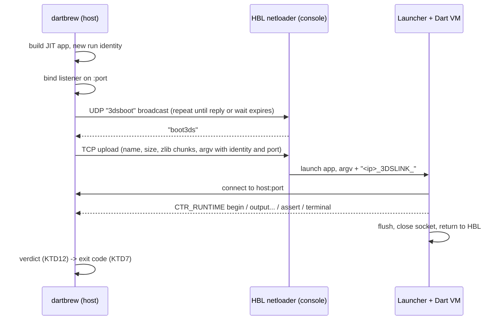
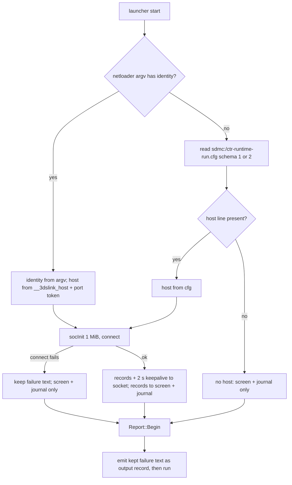
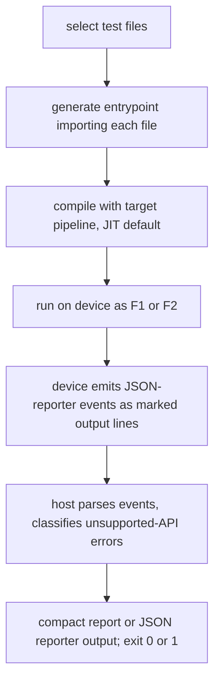
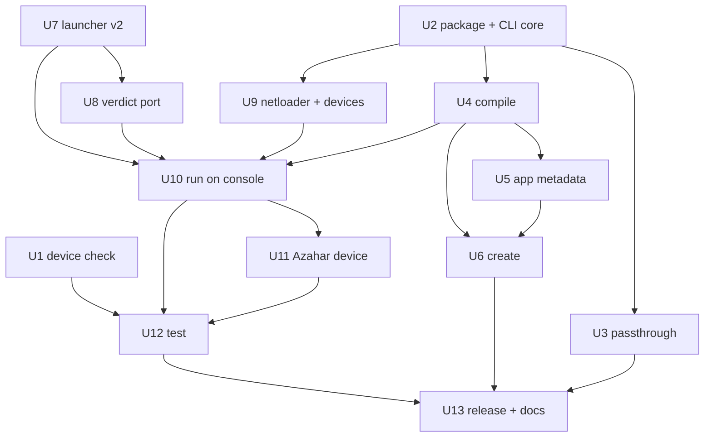

# dartbrew CLI - Plan

## Goal Capsule

- **Objective:** A developer with only the downloaded SDK can do everyday Dart work with familiar `dart`-style commands, and can run or test a program on a New 3DS or in Azahar with one command that streams the result back to their terminal.
- **Means:** Replace the `ctr` CLI with `dartbrew`, a Dart-CLI-shaped tool in which CTR is the first build target. The launcher gains network output so `run` and `test` can report back (KTD5).
- **Product authority:** The Product Contract below wins on behavior. KTDs win on mechanism within it. This plan covers the host command surface, the run/test loop, `devices`, and app metadata. Hot reload, a Dart CLI running on the console, and the NTR/HAC targets are later milestones (see How This Work Fits Together) and are not active scope.
- **Release:** dartbrew ships as 0.1.0-preview.4, after preview.3 is qualified and published unchanged with the `ctr` CLI.
- **Stop conditions:** Stop and ask if U1 shows that a call into `dart:io` kills the VM without leaving output that names the failing area. KTD10's fallback covers only fatal calls that do leave such output. Anything else would need a product decision on R14, and U12 waits for it. Also stop if the launcher's socket buffer leaves too little memory for the qualified fixtures.
- **Execution profile:** Dart CLI work runs on any host with the pinned Dart SDK. Launcher and runtime-asset work runs in the Compose toolchain (`compose.yaml`, container `ctr-dart-toolchain`). Hardware and Azahar runs are manual qualification steps done by the maintainer.
- **Open blockers:** None.

---

## Product Contract

Product Contract preservation: changed: added R18 (`dartbrew devices`) and R19 (app title, description and icon), approved by the user after a comparison with other embedded ports. The hot-reload milestone was placed after universal compatibility. Planning resolved the former Outstanding Questions as KTDs. R1-R17 are otherwise unchanged.

### Summary

`dartbrew` mirrors the `dart` command surface. Commands that are platform-independent pass through to the bundled host Dart. `create`, `compile`, `run`, `test` and `devices` are built around build targets, with CTR as the first and default target. `run` and `test` deploy to a console over Wi-Fi or launch Azahar, then stream output, test results and exit status back. None of this needs public `dart:io`, public isolates or the VM service on the console.

### Problem Frame

Today the SDK's CLI has two commands, `doctor` and `build` (`packages/ctr_dart/lib/src/native_sdk.dart:104-117`). Getting a program to run is manual: copy `SDROOT` to the SD card (usually over FTP), launch it from Homebrew Launcher, then fetch `ctr-runtime.log` to see what happened (`release/README.md:53-59`). The launcher only writes output to the top screen and that journal file (`runtime/ctr/source/main.cc:36-42`, `runtime/ctr/source/report.cc:19-20`). Any other Dart task, such as resolving packages for the IDE, analyzing, formatting or creating a project, needs a separate Dart install, even though the SDK already bundles a host Dart.

Two groups pay this cost equally. The maintainer qualifies the runtime by repeating the copy, launch and retrieve cycle for every fixture and mode, then checks pass/fail with a Python script (`runtime/ctr/results.py`) that the SDK does not ship. Preview users writing homebrew apps get a tool that looks nothing like `dart` and have no edit-run loop at all.

Other embedded ports have settled this the same way. `flutter-tizen`, `flutter-elinux` and `flutterpi_tool` wrap the upstream tool, mirror its commands and add a device-aware `run`. `cargo-3ds` mirrors `cargo`, deploys with 3dslink and runs tests on the console with output streamed back. None of them runs the CLI on the device.

### Key Decisions

- **Mirror the Dart CLI and add a run loop first.** The precedent ports deliver this first, and none of it waits on runtime work. (session-settled: user-approved — chosen over a command mirror alone, a run loop alone, or aiming at hot reload now: it gives the familiar surface plus the edit-run loop without the dart:io/VM-service milestone.) Governs R1-R15.
- **Serve the maintainer and preview users equally.** The same commands serve both, and qualification checks are an option on top. (session-settled: user-directed — chosen over prioritizing either the maintainer's qualification loop or preview users: both lose time to the same manual cycle.) Governs R12, R16.
- **Support the console and Azahar in the first version.** Azahar gives a hardware-free path for quick checks and automation. (session-settled: user-approved — chosen over console-only or Azahar-first.) Governs R10, R11.
- **Include host passthrough, `create`, `compile` and on-console `test`.** (session-settled: user-directed — the user selected all four over a smaller first set.) Governs R3-R8, R13-R15.
- **Tests are unmodified `package:test` files.** The same files run on the host with `dart test`. (session-settled: user-approved — chosen over a promised subset or a CTR-specific test package: portability for test authors.) Governs R13-R15.
- **One umbrella tool named `dartbrew`, with build targets underneath.** CTR is the first build target, and NTR and HAC can be added later without renaming. Codenames name targets because no codename covers every platform, and public names avoid the platform-holder's trademarks. (session-settled: user-directed — `dartbrew` chosen over `cart`, `dartridge`, `hbdart` and keeping `ctr`: it says what the tool is.) Governs R1, R2, R17.
- **No `ctr` command or `build` alias survives.** The SDK is still a preview, so a clean break costs little. (session-settled: user-approved — chosen over keeping compatibility aliases.) Governs R5, R17.
- **`run` and `test` default to JIT, and `compile` defaults to AOT.** This matches `dart run` and `dart compile`, and JIT skips the AOT snapshot stage so the loop builds faster. (session-settled: user-approved.) Governs R5, R9, R13.
- **Close the gaps found against other ports: a device list and app metadata.** Every Flutter port has `devices`, and cargo-3ds gives apps a title and icon by default. (session-settled: user-directed — the user selected both over leaving them out.) Governs R18, R19.
- **Ship preview.3 first, then dartbrew as preview.4.** dartbrew needs launcher changes, and those reset hardware qualification. (session-settled: user-approved — chosen over folding dartbrew into preview.3: keeps the qualification already in progress.) Governs R16.

### Requirements

**Identity and targets**

- R1. The SDK's CLI is `dartbrew`, and its user-facing text never uses the platform-holder's trademarks. It refers to the target by its codename (CTR) or by neutral wording.
- R2. Commands that build for a device accept a build target. CTR is the only target in this version and is used when none is given. Adding another target later must not require renaming commands or flags.

**Host command surface**

- R3. Platform-independent `dart` commands (at least `pub`, `analyze`, `format`, `fix`, `doc` and `info`) run through the bundled host Dart with their normal arguments, output and exit codes. No separate Dart install is needed.
- R4. `dartbrew create` makes a new CTR console-app project from a template that builds, runs and tests with `dartbrew` without edits.
- R5. `dartbrew compile` takes over everything `ctr build` does today: package resolution, offline mode, AOT and JIT output, and the staged SD-card folder. Its options are shaped like `dart compile`, and AOT is the default.
- R6. `dartbrew doctor` keeps verifying the sealed SDK.
- R7. Help text and usage errors follow `dart`'s conventions, so a Dart user can discover commands without reading CTR docs.
- R8. Commands that `dart` has but `dartbrew` does not support yet fail with a clear message. They never run silently against the host as if they targeted the console.
- R18. `dartbrew devices` lists the devices that are reachable right now: consoles with an open netloader on the local network, and Azahar when it is installed.
- R19. Built apps carry a title, description and icon that Homebrew Launcher displays. They default from the project's pubspec and a neutral built-in icon, and the project can override them.

**Run loop**

- R9. `dartbrew run` builds the project for the target and starts it on a chosen device. JIT is the default, and AOT can be selected.
- R10. Device selection accepts a console (by address, or found automatically on the local network) or Azahar.
- R11. While the program runs, its standard output and errors stream to the terminal. When it ends, `dartbrew run` exits with a status that reflects the program's result: normal exit, uncaught error, or crash/lost connection.
- R12. An option on `run` reports the qualification verdict (pass, fail or incomplete, with run and artifact identity) that `runtime/ctr/results.py` produces today, without needing Python.

**Tests on device**

- R13. `dartbrew test` runs a project's `package:test` files on the chosen device and reports per-test results and a summary in the style of `dart test`. It exits non-zero when any test fails.
- R14. A test that uses an API the console does not support yet (files, sockets, isolates, FFI, or `package:test`'s host-side hybrid features) is reported as a failed test that names the unsupported area. It does not crash or hang the whole run.
- R15. The same test files still run unchanged on the host with plain `dart test`.

**Distribution and docs**

- R16. The SDK download, its archive names and the qualification and release tooling use the `dartbrew` name.
- R17. The docs and SDK README describe the new commands and the 3dslink and Azahar workflow. They state that `ctr build` was replaced by `dartbrew compile`.

### Key Flows

- F1. Run on a console
  - **Trigger:** The developer runs `dartbrew run` in a project with a console selected.
  - **Steps:** dartbrew builds the app. It waits for the console's Homebrew Launcher netloader to be open (press Y on the console) and sends the app. The app starts and its output streams to the terminal. The program ends, and dartbrew exits with the matching status.
  - **Covered by:** R9, R10, R11
- F2. Run in Azahar
  - **Trigger:** The developer runs `dartbrew run` with Azahar selected.
  - **Steps:** dartbrew builds the app, prepares the run in Azahar's emulated SD card and launches it. Output streams back while it runs, falling back to the journal on the emulated SD card (KTD8). When the program ends, dartbrew closes Azahar and exits with the matching status.
  - **Covered by:** R9, R10, R11
- F3. Test on device
  - **Trigger:** The developer runs `dartbrew test`.
  - **Steps:** dartbrew finds the test files and builds them into one app for the target. It runs that app on the device as in F1 or F2, streams per-test results and prints a summary.
  - **Covered by:** R13, R14

### Acceptance Examples

- AE1. **Covers R11.** Given a program that throws an uncaught exception, when it runs via `dartbrew run`, then the error and stack trace appear in the terminal and dartbrew exits non-zero.
- AE2. **Covers R11.** Given the console loses Wi-Fi mid-run, when the connection drops, then dartbrew reports a lost connection, not a pass, and exits non-zero.
- AE3. **Covers R14.** Given a test file with one pure-logic test and one test that reads a file, when run with `dartbrew test` on CTR, then the first passes and the second fails with a message naming file I/O as unsupported, and the summary shows 1 passed and 1 failed.
- AE4. **Covers R8.** Given `dart` has a command that dartbrew has not adopted, when the user runs it through `dartbrew`, then dartbrew says it is not supported for the target and exits with a usage error.
- AE5. **Covers R10, F1.** Given no console's netloader is reachable, when `dartbrew run` waits for one, then it tells the user to open the netloader in Homebrew Launcher and gives up with a clear error after a bounded wait.
- AE6. **Covers R19.** Given a project whose pubspec has `name: snake` and a description, with no overrides, when it is compiled and loaded in Homebrew Launcher, then the menu shows "snake", the description and the default icon.

### Scope Boundaries

**Deferred for later**

- Hot reload, the debugger and DevTools (scheduled in How This Work Fits Together).
- A `dart` CLI or REPL that runs on the console itself.
- The NTR and HAC build targets themselves (only the target concept is in scope, per R2).
- A CTR-aware analyzer lint that flags APIs the console does not support yet. `dartbrew analyze` checks against the host libraries in this version.
- A saved device list (`devices add`-style configuration).
- Renaming the GitHub repository.
- Starting Homebrew Launcher's netloader automatically, or a launcher-side listener that would remove the per-run Y press.
- Passing command-line arguments from `dartbrew run` to the program's `main`.

**Not done by this work**

- Making `dart:io`, isolates or FFI work on the console. That is the separate universal-compatibility milestone. This work only reports those gaps clearly (R14).

<!-- ce-section: work-relationships -->
### How This Work Fits Together

This plan covers the Dart-shaped host CLI and the run/test loop for the CTR target. The breakdown below is the current understanding, not a committed roadmap.

- Universal Dart compatibility (`dart:io` files and sockets, public isolates, FFI) — the next runtime milestone. It can proceed independently of this plan. Once it lands, more tests pass under R14 without changing dartbrew.
  - Hot reload, debugger and DevTools — the milestone after universal compatibility. Depends on its sockets plus a VM service on the console, and works in JIT mode only. Shares this plan's `run` command and device selection.
  - Dart CLI on the console — Depends on universal compatibility (files, isolates). Still to decide whether it is worth building at all.
- NTR and HAC build targets — Depend on this plan's target concept (R2). Each target needs its own runtime port and transport first. HAC's netloader uses different ports and messages.

### Dependencies / Assumptions

- The New 3DS's Homebrew Launcher netloader accepts apps over the local network using the protocol documented in Sources, and it requires a Y press before each transfer.
- Azahar launches a `.3dsx` given on its command line, passes it no arguments, does not exit when the app exits, and maps emulated sockets to real host sockets.
- Azahar 2126.2 already runs CLI-built apps (`docs/ctr-native-sdk.md:36-37`).
- The shipped SDK contains no Python interpreter (`release/README.md:16-20`). This is from the docs and was not checked against a built archive.
- The CTR platform dill includes every `vm` library, so `package:test` code compiles for CTR. Only `CTR_*` natives resolve at runtime (`runtime/ctr/source/embedder.cc:130-138`).

### Outstanding Questions

**Deferred to Planning**

- None remain. Planning resolved them as KTD3 (target selection), KTD6 (netloader client), KTD8 (Azahar output), KTD9 (test packaging and channel), KTD7 and KTD12 (verdict location) and KTD2 (host-only `dart` commands).

### Sources / Research

- `packages/ctr_dart/lib/src/native_sdk.dart` — current command set (`:104-117`), host Dart `pub get` (`:271-279`), JIT skips the AOT snapshot (`:290-301`), staging (`:396-413`).
- `runtime/ctr/source/main.cc:69` — the launcher starts no service or kernel isolate and does no `dart:io` bootstrap. It has no network code.
- `runtime/ctr/results.py` — the journal verdict rules R12 must preserve.
- Rename footprint: `release/build_native_sdk.py:85-92`, `release/bundle_native_sdk.py:69,92,96`, `release/check_release.py:7,36`, `release/native_dependencies.py:60`, `.github/workflows/ci.yml`, `docs/`. User-facing "3DS" text appears in `native_sdk.dart:114`, `release/README.md`, `release/preview.json:6` and `release/bundle_native_sdk.py:92`.
- Precedents, read from source: flutter-tizen `lib/executable.dart` and `lib/commands/test.dart`, flutter-elinux `lib/executable.dart`, flutterpi_tool `lib/src/executable.dart`, cargo-3ds `src/command.rs`, ctru-rs `test-runner`, rust3ds `test-runner/run-tests/docker`.
- Netloader protocol: devkitPro 3dslink `main.c` and new-hbmenu `netloader.c`. Discovery is a UDP `3dsboot` broadcast to port 17491 answered by `boot3ds`. Upload is TCP to port 17491, with little-endian lengths, zlib chunks of at most 16 KiB and an argv block. The console appends `<hex ip>_3DSLINK_` to argv. 3dslink is GPLv3, hbmenu's netloader has no license file, and libctru is zlib-licensed.
- Azahar (`azahar-emu/azahar`, tag 2126.2): `citra_qt.cpp` command line, `file_util.cpp` and `common_paths.h` for the `<UserDir>/sdmc` layout, `config.cpp` for `emu.ini` custom storage.
- `package:test` (dart-lang/test): `test_api/lib/backend.dart` (Declarer, LocalTest, Suite), `test/doc/json_reporter.md` (public, versioned event protocol), `test_core/lib/src/runner/hack_register_platform.dart` (the plugin route this plan does not take).

---

## Planning Contract

### Key Technical Decisions

- KTD1. **Rename the package to `packages/dartbrew` with entry point `bin/dartbrew.dart`.** The CLI keeps the existing exit-code mapping (64 usage, 65 format, 78 file system, child code for process failures; `native_sdk.dart:118-132`). The version define becomes `DARTBREW_VERSION`. Compose project and container names, producer component artifact names (`ctr-runtime-assets.zip`, `ctr-binutils-*`) and the on-SD `ctr-runtime*` file names keep their CTR names: they are target or infrastructure names, not the product name. Governs R1, R16.
- KTD2. **dartbrew-owned commands use `package:args` Command classes, and passthrough is an explicit allowlist.** `pub`, `analyze`, `format`, `fix`, `doc` and `info` forward their raw arguments to `host-dart/bin/dart` with inherited stdio and return the child's exit code unchanged. Host-only `dart` commands (`build`, `install`, `installed`, `uninstall`, `migrate`, `devtools`, and running a `.dart` file directly; `dartbrew compile` itself only builds for targets) are known-unsupported and get a message naming the reason. Anything else is a usage error (exit 64). This differs from the Flutter ports, which link `flutter_tools` as a library: `dartdev` is not a reusable library, so forwarding is the only route. cargo-3ds forwards to `cargo` the same way. Governs R3, R7, R8.
- KTD3. **The target is a `--target` option (default `ctr`) on `compile`, `run`, `test`, `create` and `devices`.** Allowed values come from the target registry, so a new target adds a value without new commands. A target owns its compile pipeline, packaging, device transports and test entrypoint. A positional target (`flutter build <platform>`) was rejected because `run` and `test` would need a different shape from `compile`. Governs R2.
- KTD4. **SDK verification has two levels.** `doctor`, `compile`, `run` and `test` hash every sealed file (today's `NativeSdk.load`). Passthrough checks only the manifest, host match and the `dart` tool path, because hashing the whole `host-dart/` tree on every `format` call adds startup delay. Governs R3, R6.
- KTD5. **Launcher contract v2: identity from argv or cfg, output over a socket when a host is given.** The launcher reads run identity from its argv when launched by the netloader, otherwise from `sdmc:/ctr-runtime-run.cfg`. The cfg schema goes to 2 and allows one optional `host=<ipv4>:<port>` line after the eight identity lines. On console runs, the host address comes from libctru's `__3dslink_host` (the netloader's trailing argv entry) plus a port token in argv. When a host is known, the launcher initializes sockets with a 1 MiB aligned buffer and connects before `Report::Begin`. If the connection fails, it keeps the failure text and emits it as an `output` record only after `Begin` succeeds, because `Report::Output` before `Begin` marks the run failed (`runtime/ctr/source/report.cc`). Once connected, every `CTR_RUNTIME` record line goes over the socket as well as to the screen and journal. The launcher also writes a bare newline keepalive to the socket every 2 seconds from its main loop, under the same lock as `Report::Emit`. The keepalive never goes to the journal, and verdict parsing already ignores lines without the `CTR_RUNTIME ` prefix. The existing `terminal` record is the end-of-run signal, followed by flush, socket close and `socExit`. Without a host, behavior is unchanged. This ships as new runtime assets and is requalified for preview.4. Governs R9, R10, R11.
- KTD6. **The netloader client is a clean-room Dart implementation inside dartbrew.** It covers UDP discovery, the TCP upload with zlib chunks, the argv block, and a host listener bound before the upload starts so a fast app cannot miss it. The listener uses a fixed default TCP port (17491, the port `3dslink -s` uses), overridable with `--host-port`, so users can add one firewall rule ahead of time. 3dslink is GPLv3 and would add a per-host native binary, and the protocol is about 150 lines. A transport interface keeps HAC's different ports and messages separate. Governs R10, R11, R18.
- KTD7. **Run outcome maps to exit codes in one place.** `pass` exits 0. `fail` (uncaught error, failed cleanup) exits 255, matching `dart run`. `incomplete` exits 1 and prints its reason: lost connection, START pressed, timeout, or no terminal record. Two deadlines catch silent failures, because a console that drops off Wi-Fi or freezes sends no close. If the app has not connected back 15 seconds after the upload is acknowledged, the reason names a likely host firewall block and the port. If no bytes, including keepalives, arrive for 10 seconds, the reason is lost connection. Programs cannot set their own exit code yet, because `exit()` lives in `dart:io`. The verdict is computed by a Dart port of `results.py` (KTD12) over the streamed records. Governs R11, R12.
- KTD8. **Azahar runs use the cfg file plus the socket, with the journal as fallback.** dartbrew finds Azahar from `--azahar <path>`, then the `DARTBREW_AZAHAR` environment variable, then PATH names per OS. It resolves the emulated SD card from a portable `user/` directory, then `emu.ini` custom storage, then the per-OS default, with a `DARTBREW_AZAHAR_SDMC` override. It writes a schema-2 cfg with `environment=azahar` and `host=127.0.0.1:<port>`, launches `azahar <app>.3dsx`, and accepts the socket connection. If none arrives within a grace period, it tails `ctr-runtime.log` on the emulated SD card, filtering by run ID. After the terminal record or a timeout it closes Azahar, because Azahar returns to its game list and stays open. Readiness comes from records, not a fixed sleep, which is the lesson rust3ds CI recorded. Governs R10, R11.
- KTD9. **`dartbrew test` builds one app per run with a dartbrew-generated entrypoint and its own host runner.** The entrypoint imports every selected test file under its own prefix and drives `package:test_api`'s backend (Declarer, LocalTest, Suite) inside a zone, so the global `test()` and `group()` find the declarer. It emits JSON-reporter-shaped events (`suite`, `group`, `testStart`, `print`, `error`, `testDone`) as `output` lines with a marker prefix. The host runner renders a `dart test`-style compact report, supports `--name`/`--plain-name` (baked into the generated entrypoint, since `main` gets no argv) and `--reporter json`, and exits 1 on any failure. One app per run avoids a Y press per test file. The `test_core` platform-plugin route (Flutter's) was rejected: it needs a device-to-host return channel the launcher lacks, pulls in analyzer, vm_service and coverage, and uses imports marked as needing the test authors' permission. dartbrew checks that the project's resolved `test_api` falls in a tested range and warns otherwise. Governs R13, R15.
- KTD10. **Unsupported-API failures are classified on the host from the error text.** The device runner catches each test's error as usual. The host maps known failure shapes (unresolved `dart:io` natives, isolate spawn failure, FFI lookups, hybrid and `spawnHybridUri` calls) to a named area in the failure message. U1 decides the exact shapes. If U1 finds that some calls are fatal to the VM but leave output naming the area, the host reports the remaining tests in that file as failed with that area named, and records the fallback in the docs. Fatal calls that leave no such output fall under the Goal Capsule stop condition. Governs R14.
- KTD11. **App metadata is written as an SMDH block in the 3DSX extended header.** `encode3dsx` gains the extended header with the SMDH offset (RomFS stays absent). Title and description default from pubspec `name` and `description`. A top-level `dartbrew:` pubspec key can override `title`, `description`, `author` and `icon` (a PNG path). Icons are scaled to 48x48 and 24x24 and encoded in the tiled RGB565 layout. A neutral default icon is embedded in the CLI. PNG decoding uses `package:image`, which adds a license file to `release/licenses/`. Governs R19.
- KTD12. **The verdict rules live in Dart and Python with shared test vectors.** `runtime/ctr/results.py` stays for CI and the runtime runbook. Its cases move into a JSON vector file that both the Python tests and the Dart port read, so the two cannot drift. Governs R12.
- KTD13. **Process and socket seams for testing.** Commands receive a process starter and socket factories, so tests can run commands against a fake SDK (extended with `tools` and `runtime` entries pointing at stub executables) and fake netloader and Azahar endpoints. The existing tests have no process fakes (`packages/ctr_dart/test/native_sdk_test.dart:12-25`).

### High-Level Technical Design

**Command surface (directional sketch):**

```text
dartbrew <command> [arguments]

owned:        create   [--target ctr] <directory>
              compile  [--target ctr] [--mode aot|jit] [-o <dir>] [--offline] [--project-directory <dir>] <entry.dart>
              run      [--target ctr] [--mode jit|aot] [-d <device>] [--wait <s>] [--timeout <s>] [--host-port <n>] [--verdict] [--azahar <path>] [<entry.dart>]
              test     [--target ctr] [--mode jit|aot] [-d <device>] [--name <re>] [--plain-name <s>] [--reporter compact|json] [<paths>...]
              devices  [--target ctr] [--wait <s>]
              doctor
passthrough:  pub | analyze | format | fix | doc | info   -> host-dart/bin/dart <same args>
unsupported:  build | install | installed | uninstall | migrate | devtools | <file.dart> -> message, exit 64
device:       -d <ipv4> | -d console (discover; default) | -d azahar
```

**Console run (F1):**



**Launcher identity and output (KTD5):**



**Outcome to exit code (KTD7):**

| Stream ends with | Verdict | Exit | Message |
| --- | --- | --- | --- |
| `terminal` pass, cleanup pass | pass | 0 | none |
| `terminal` fail, or cleanup fail | fail | 255 | error text already streamed |
| `terminal` incomplete (START pressed) | incomplete | 1 | stopped on console |
| socket closed with no `terminal` | incomplete | 1 | lost connection |
| no connection 15 s after upload ack | incomplete | 1 | app never connected back; check the host firewall for inbound TCP on the port |
| no bytes for 10 s (keepalives included) | incomplete | 1 | lost connection |
| `--timeout` reached | incomplete | 1 | timed out |
| malformed or interleaved records | incomplete | 1 | verdict reason from KTD12 |

**Test pipeline (KTD9, KTD10):**



### Output Structure

```text
packages/dartbrew/
  bin/dartbrew.dart
  lib/src/
    cli.dart                 # runner, exit mapping, global options
    sdk.dart                 # NativeSdk with full and quick verification
    stage_runner.dart        # extracted from _build
    process.dart             # process starter seam
    commands/                # create, compile, run, test, devices, doctor, passthrough
    targets/target.dart      # target interface and registry
    targets/ctr/             # pipeline, 3dsx + smdh, netloader, azahar, test entrypoint, templates
    device/verdict.dart      # results.py port
    device/stream.dart       # CTR_RUNTIME line parsing
    test_runner/             # host reporter and event model
  test/
```

The per-unit Files lists are authoritative. This tree only shows the intended shape.

### Assumptions

- The netloader passes the argv block from the upload to the app, as both protocol sources show.
- A 1 MiB socket buffer fits alongside the qualified fixtures' memory use. U7 qualification checks this.
- Azahar's emulated sockets reach `127.0.0.1` on the host. If they do not, KTD8's journal fallback still satisfies R11.
- `package:image` decodes PNG on all four hosts without native code.

### Sequencing

The device check (U1) and the launcher change (U7) start first because they carry the most risk and need the Compose toolchain and hardware. The CLI restructure (U2) unblocks every command unit. `run` (U10) joins the launcher, verdict and transport work. `test` (U12) comes after `run` and U1. Release tooling and docs (U13) close the work and feed preview.4 qualification.



---

## Implementation Units

| U-ID | Title | Key files | Depends on |
| --- | --- | --- | --- |
| U1 | Device check for test code and unsupported APIs | `test/programs/`, `docs/ctr-supported-features.md` | none |
| U2 | Rename package and restructure CLI core | `packages/dartbrew/`, `.github/workflows/ci.yml` | none |
| U3 | Host passthrough and unsupported commands | `packages/dartbrew/lib/src/commands/passthrough.dart` | U2 |
| U4 | `compile` command and CTR target pipeline | `packages/dartbrew/lib/src/targets/ctr/` | U2 |
| U5 | App title, description and icon | `packages/dartbrew/lib/src/targets/ctr/smdh.dart` | U4 |
| U6 | `create` command and template | `packages/dartbrew/lib/src/commands/create.dart` | U4, U5 |
| U7 | Launcher contract v2 | `runtime/ctr/source/`, `runtime/ctr/results.py` | none |
| U8 | Dart verdict port with shared vectors | `packages/dartbrew/lib/src/device/verdict.dart` | U7 |
| U9 | Netloader client and `devices` | `packages/dartbrew/lib/src/targets/ctr/netloader.dart` | U2 |
| U10 | `run` on a console | `packages/dartbrew/lib/src/commands/run.dart` | U4, U7, U8, U9 |
| U11 | Azahar device | `packages/dartbrew/lib/src/targets/ctr/azahar.dart` | U10 |
| U12 | `test` command | `packages/dartbrew/lib/src/commands/test.dart` | U1, U10, U11 |
| U13 | Release tooling, docs and preview.4 | `release/`, `docs/`, `README.md` | U3, U6, U12 |

### U1. Device check for test code and unsupported APIs

**Goal:** Find out, on the console and in Azahar, whether `package:test` code loads under the CTR runtime and how calls into `dart:io`, isolates and FFI fail.

**Requirements:** R14, R13 (de-risks KTD9 and KTD10).

**Dependencies:** none.

**Files:**
- Create: `test/programs/unsupported_apis.dart` (one guarded call per area: file read, socket connect, `Process.run`, `Isolate.spawn`, `DynamicLibrary.open`, `stdout.write`, `exit`)
- Create: `test/projects/test_probe/` (its own pubspec pinning `test` 1.33.0; the entrypoint imports `package:test/test.dart` and runs two `test()` calls inside a zone holding a `test_api` Declarer, as KTD9 specifies). A separate project keeps `test/programs/` free of a pubspec, which would change the packages stage for every qualified fixture.
- Modify: `docs/ctr-supported-features.md` (record the observed failure shape per area)

**Approach:**
1. Build both with today's `ctr build` in JIT and AOT, in the Compose toolchain, the probe with `--project-directory`.
2. Run them on the console and in Azahar using the existing manual SD-card flow.
3. For each area, record whether the call throws a catchable error (and its type and message), aborts the isolate, or kills the VM.
4. Record whether the probe loads, whether library initializers on the `package:test` import path touch `dart:io` natives, and its peak memory in JIT and AOT with 1 MiB reserved for the socket buffer.

**Execution note:** This is an experiment that gates U12. Record outcomes before U12's design is finalized. If any area kills the VM, apply the Goal Capsule stop condition.

**Patterns to follow:** existing fixtures in `test/programs/` with expected output in `test/expected/`; journal checking with `runtime/ctr/results.py`.

**Test scenarios:**
- Test expectation: none — this unit produces evidence, not shipped behavior. Its findings become the input to U12's classification tests.

**Verification:** `docs/ctr-supported-features.md` names the failure shape for files, sockets, processes, isolates, FFI, `stdout` and `exit` on both the console and Azahar, and whether `test_api` code runs.

### U2. Rename package and restructure CLI core

**Goal:** Move `packages/ctr_dart` to `packages/dartbrew` with a `dartbrew` command runner, the target registry, two-level SDK verification, the stage runner and test seams, and keep `doctor` working.

**Requirements:** R1, R2, R6, R7; KTD1, KTD3, KTD4, KTD13.

**Dependencies:** none.

**Files:**
- Move: `packages/ctr_dart/` to `packages/dartbrew/` (pubspec `name: dartbrew`, `executables: dartbrew:`)
- Create: `packages/dartbrew/bin/dartbrew.dart`, `packages/dartbrew/lib/src/cli.dart`, `packages/dartbrew/lib/src/sdk.dart`, `packages/dartbrew/lib/src/stage_runner.dart`, `packages/dartbrew/lib/src/process.dart`, `packages/dartbrew/lib/src/targets/target.dart`, `packages/dartbrew/lib/src/commands/doctor.dart`
- Create: `packages/dartbrew/analysis_options.yaml` (recommended lints)
- Modify: `.github/workflows/ci.yml` (working directory), `release/build_native_sdk.py` (package path, entry point, `DARTBREW_VERSION`, binary name), `release/native_dependencies.py`, `release/bundle_native_sdk.py` (binary name)
- Test: `packages/dartbrew/test/cli_test.dart`, `packages/dartbrew/test/sdk_test.dart`, `packages/dartbrew/test/stage_runner_test.dart`, `packages/dartbrew/test/support/fake_sdk.dart`

**Approach:**
1. Split `_SdkCommand` (`native_sdk.dart:135-219`) into one Command class per command, under one runner named `dartbrew` with a neutral description.
2. Keep the exit-code mapping unchanged (KTD1).
3. Extract the `run` closure (`native_sdk.dart:234-270`) into a stage runner, keeping stage names, `work/commands.json` and the per-stage logs.
4. Add a quick verification mode to `NativeSdk` for passthrough (KTD4).
5. Add the target interface and register `ctr` as the only target (KTD3).
6. Extend the fake SDK so tests can map `tools` to stub executables (KTD13).

**Patterns to follow:** `native_sdk_test.dart` table-driven groups and temp-directory setup; `NativeSdk.asset` as the only way to address SDK files.

**Test scenarios:**
- `dartbrew --help` exits 0, lists `create`, `compile`, `run`, `test`, `devices`, `doctor` and the passthrough commands, and contains no "3DS".
- `dartbrew --version` prints the injected version, or `development` when none is defined.
- An unknown command exits 64 with usage on stderr and empty stdout.
- `doctor` on a valid fake SDK prints the verified-asset count and exits 0.
- `doctor` on an SDK with one modified file exits non-zero and names the file.
- Quick verification accepts an SDK whose `host-dart/` content changed but whose manifest and `dart` path are valid. Full verification rejects it.
- `--target ntr` is rejected with a usage error listing `ctr` as the allowed value.
- The stage runner writes `work/<stage>.log` and `work/commands.json` and throws with the stage name when a stub tool exits non-zero.

**Verification:** CI's Dart job passes in `packages/dartbrew`. A locally built SDK's binary is named `dartbrew` and passes the `build_native_sdk.py` smoke test (`--help`, `--version`, `doctor` with an empty PATH).

### U3. Host passthrough and unsupported commands

**Goal:** Forward allowlisted `dart` commands to the bundled host Dart, and reject host-only commands with a clear message.

**Requirements:** R3, R7, R8, AE4; KTD2, KTD4.

**Dependencies:** U2.

**Files:**
- Create: `packages/dartbrew/lib/src/commands/passthrough.dart`
- Test: `packages/dartbrew/test/passthrough_test.dart`

**Approach:**
1. Register each allowlisted command with an argument parser that accepts anything, so flags like `--set-exit-if-changed` and `pub get --offline` pass through untouched.
2. Start `host-dart/bin/dart` with inherited stdio and return its exit code verbatim.
3. Register the known-unsupported list from KTD2 with a message naming why each is unavailable for the target.

**Patterns to follow:** process seam from U2; `dart` exit-code conventions (64 for usage).

**Test scenarios:**
- `dartbrew format --set-exit-if-changed lib` starts the stub `dart` with exactly `format --set-exit-if-changed lib` and returns its exit code 1 unchanged.
- `dartbrew pub get --offline` passes the arguments through, and the stub's exit code 0 is returned.
- `dartbrew analyze` returning 3 (infos) makes `dartbrew` exit 3.
- `dartbrew help format` and `dartbrew format --help` show the host `dart format` help via the stub.
- Covers AE4. `dartbrew build` and `dartbrew install` exit 64 with a message that the command is not supported for the CTR target.
- `dartbrew hello.dart` exits 64 and suggests `dartbrew run`.
- Passthrough runs with quick verification: a fake SDK with a modified `host-dart` file still forwards.

**Verification:** Each allowlisted command produces the same output and exit code as running the bundled `dart` directly.

### U4. `compile` command and CTR target pipeline

**Goal:** Replace `ctr build` with `dartbrew compile`, producing the same artifacts through the CTR target's pipeline.

**Requirements:** R5, R2; KTD3.

**Dependencies:** U2.

**Files:**
- Create: `packages/dartbrew/lib/src/commands/compile.dart`, `packages/dartbrew/lib/src/targets/ctr/pipeline.dart`, `packages/dartbrew/lib/src/targets/ctr/package.dart`
- Move: `native_elf.dart` and `native_directory.dart` under `packages/dartbrew/lib/src/targets/ctr/` and `packages/dartbrew/lib/src/`
- Test: `packages/dartbrew/test/compile_test.dart`, existing `native_elf_test.dart` and `native_directory_test.dart`

**Approach:**
1. Move `_build` (`native_sdk.dart:221-414`) into the CTR target. Split it into a build step (kernel, snapshot or JIT payload, assemble, link, 3DSX) and a packaging step (`artifact.json`, `run.json`, `SDROOT`, cfg).
2. `compile` runs both steps. `run` and `test` reuse the build step with their own packaging.
3. Keep the stage names and output layout the release integration test relies on.
4. Derive the `fixture` identity token from the pubspec name when the old `--fixture` flag is absent, within the existing `^[A-Za-z0-9_-]{1,64}$` rule.
5. `compile` keeps writing the schema-1 cfg for the manual SD-card flow. U7 keeps schema 1 valid.

**Patterns to follow:** current `_build` validation (entry inside project, new output directory outside the SDK) and the exclusive directory creation in `native_directory.dart`.

**Test scenarios:**
- With stub tools, `compile --mode aot` runs the `packages`, `kernel`, `snapshot`, `assemble-payload`, `assemble-program` and `link` stages in order and writes `application.3dsx`, `artifact.json`, `run.json` and `SDROOT`.
- `compile --mode jit` skips the `snapshot` stage.
- Without `--mode`, compile uses AOT.
- An existing output directory fails with exit 78 and leaves it untouched.
- An entry outside the project directory fails with a usage error.
- A project with no `pubspec.yaml` skips the `packages` stage.
- `--offline` passes `--offline` to `pub get`.
- The success message names `application.3dsx` and contains no "3DS" trademark text.

**Verification:** The opt-in release integration test, updated in U13, passes against a built SDK using `dartbrew compile`.

### U5. App title, description and icon

**Goal:** Give compiled apps an SMDH block so Homebrew Launcher shows a title, description and icon.

**Requirements:** R19, AE6; KTD11.

**Dependencies:** U4.

**Files:**
- Create: `packages/dartbrew/lib/src/targets/ctr/smdh.dart`, `packages/dartbrew/lib/src/targets/ctr/default_icon.dart`
- Modify: `packages/dartbrew/lib/src/targets/ctr/native_elf.dart` (extended 3DSX header with SMDH offset and size), `packages/dartbrew/pubspec.yaml` (`image` dependency)
- Create: `release/licenses/image.LICENSE`
- Test: `packages/dartbrew/test/smdh_test.dart`, `packages/dartbrew/test/native_elf_test.dart`

**Approach:**
1. Read the pubspec `name`, `description` and the optional `dartbrew:` overrides.
2. Encode the SMDH with UTF-16 titles in every language slot, and icons resized to 48x48 and 24x24 and written in tiled RGB565.
3. Append the SMDH after the 3DSX sections and point the extended header at it. RomFS stays zero.
4. Truncate over-long titles to the SMDH field limits and warn.

**Patterns to follow:** the byte-level tests in `native_elf_test.dart`; the Azahar 3DSX loader layout already cited in `docs/ctr-native-sdk.md:97`.

**Test scenarios:**
- Covers AE6. A pubspec with `name: snake` and a description produces an SMDH whose short title is "snake" and whose long description matches.
- A `dartbrew: title:` override replaces the pubspec name.
- A title longer than the field limit is truncated and a warning is printed.
- A 64x64 PNG icon override produces 48x48 and 24x24 icon data of the expected byte sizes.
- A missing icon path fails compile with a file-system error naming the path.
- No override uses the embedded default icon.
- The 3DSX header declares the extended header size, and the SMDH offset points at bytes beginning with the `SMDH` magic.
- With metadata present, the code, rodata and data sections are byte-identical to the build without metadata.

**Verification:** A compiled app shows its title, description and icon in Homebrew Launcher and in Azahar's game list (checked during U13 qualification).

### U6. `create` command and template

**Goal:** Generate a CTR console-app project that compiles, runs and tests with dartbrew unchanged.

**Requirements:** R4, R15, R19; KTD3.

**Dependencies:** U4, U5.

**Files:**
- Create: `packages/dartbrew/lib/src/commands/create.dart`, `packages/dartbrew/lib/src/targets/ctr/templates.dart`
- Test: `packages/dartbrew/test/create_test.dart`

**Approach:**
1. Write the template from embedded strings, because `dart create` has no extension point.
2. The template contains `pubspec.yaml` (SDK constraint `>=3.11.0 <4.0.0`, `test` dev dependency, a `dartbrew:` metadata block), `bin/main.dart` (seeded from `test/programs/hello.dart`), `test/main_test.dart` (pure-logic tests only), `analysis_options.yaml` and a README naming the dartbrew commands.
3. Run `pub get` through the bundled `dart` unless `--no-pub` is given, like `dart create`.
4. Refuse a non-empty target directory unless `--force` is given.

**Patterns to follow:** `dart create -t console` layout; the qualified sample `test/programs/hello.dart`.

**Test scenarios:**
- `create snake` writes the five files, and the pubspec name is `snake`.
- A name that is not a valid package name exits 64.
- A non-empty directory exits non-zero without writing, unless `--force` is given.
- `--no-pub` skips the stub `dart pub get`. Otherwise it runs once in the new directory.
- The generated test file imports only `package:test/test.dart` and the project library.
- The generated project passes `dart analyze` with the host SDK (integration test, opt-in like the release integration test).

**Verification:** A freshly created project passes `dartbrew compile`, `dartbrew run -d azahar`, `dartbrew test -d azahar` and plain `dart test` during U13 qualification.

### U7. Launcher contract v2

**Goal:** Let the launcher take run identity from netloader argv and send its records to a host over a socket, keeping SD-card runs working.

**Requirements:** R9, R10, R11; KTD5.

**Dependencies:** none.

**Files:**
- Modify: `runtime/ctr/source/main.cc`, `runtime/ctr/source/report.cc`, `runtime/ctr/source/report.h`
- Create: `runtime/ctr/source/link.cc`, `runtime/ctr/source/link.h` (socket setup, connect, write, teardown)
- Modify: `runtime/ctr/results.py` (accept cfg and begin schema 2), `runtime/ctr/Makefile`
- Modify: `release/freeze_runtime.py` (new object), `docs/runbooks/ctr-runtime.md`
- Test: `runtime/ctr/test/test_results.py`, `runtime/ctr/test/report_test.cc` (run by the Makefile `host-test` target)

**Approach:**
1. Parse identity tokens from `argv` when present. Fall back to the cfg file otherwise.
2. Accept cfg schema 1 (eight lines) and schema 2 (eight lines plus an optional `host=` line).
3. Resolve the host from `__3dslink_host` plus an argv port token, or from the cfg `host=` line.
4. When a host is known, call `socInit` with a 1 MiB, 0x1000-aligned buffer and connect before `Report::Begin`. On failure, keep the failure text, continue without the socket, and emit the text as an `output` record right after `Begin` succeeds. Never call `Report::Output` before `Begin`.
5. Route `Report::Emit` (`report.cc:18-21`) to the socket as well as stdout and the journal.
6. While connected, write a bare newline keepalive to the socket every 2 seconds from the main loop, holding the lock `Report::Emit` uses (KTD5).
7. After the terminal record: flush, close, `socExit`, free the buffer.
8. Rebuild runtime assets with `freeze_runtime.py` and requalify the hello, async, exceptions and gc_stress fixtures in both modes.

**Patterns to follow:** existing `Report` validation of the eight cfg keys; the qualification flow in `docs/runbooks/ctr-runtime.md`.

**Test scenarios:**
- `results.py` accepts a schema-2 begin record and still accepts schema 1.
- `report_test.cc`: `Begin` accepts schema 1, accepts schema 2 with or without a `host=` line, and rejects a schema-2 cfg whose ninth line is not `host=`.
- `report_test.cc`: an `Output` call before `Begin` is never made on the connect-failure path. The kept failure text appears as the first `output` record after `begin`.
- On device: a netloader launch with identity argv produces a begin record whose run ID matches the argv token, with no cfg on the SD card.
- On device: an SD-card launch with a schema-1 cfg behaves exactly as today (no socket, journal written).
- On device: a launch whose host is unreachable still writes the journal and emits an output record naming the connect failure.
- On device: all four fixtures pass in AOT and JIT with the socket active, matching `test/expected/`.

**Verification:** Runtime assets rebuild in Compose. The qualified fixtures pass on the console and in Azahar with records received over the socket and in the journal.

### U8. Dart verdict port with shared vectors

**Goal:** Compute the same verdict as `results.py` in dartbrew from a record stream.

**Requirements:** R12; KTD7, KTD12.

**Dependencies:** U7.

**Files:**
- Create: `packages/dartbrew/lib/src/device/stream.dart`, `packages/dartbrew/lib/src/device/verdict.dart`
- Create: `runtime/ctr/test/verdict_vectors.json`
- Modify: `runtime/ctr/test/test_results.py` (read the vectors)
- Test: `packages/dartbrew/test/verdict_test.dart`

**Approach:**
1. Move the existing `test_results.py` cases into the JSON vector file, each with an input journal, a `run.json` identity and the expected outcome and reason.
2. Port the rules line by line: prefix filtering, malformed and interleaved records, duplicate begin or terminal, cleanup assertion, unknown events, crash observation.
3. Make the parser incremental, so `run` can show output records as they arrive and compute the verdict at the end.

**Patterns to follow:** `runtime/ctr/results.py` (59 lines) and its test table.

**Test scenarios:**
- Every vector in `verdict_vectors.json` yields the expected outcome and reason in Dart and in Python.
- A journal truncated at each record boundary yields `incomplete`.
- A stream with records from an older run before the current begin ignores them. Once the current begin has arrived, an older run's record makes the verdict `incomplete` with the interleaved reason.
- Feeding the stream one byte at a time gives the same verdict as feeding it whole.

**Verification:** Both test suites pass against the same vector file.

### U9. Netloader client and `devices`

**Goal:** Discover consoles, upload an app with argv through the Homebrew Launcher netloader, and list reachable devices.

**Requirements:** R10, R18, AE5; KTD6, KTD3.

**Dependencies:** U2.

**Files:**
- Create: `packages/dartbrew/lib/src/targets/ctr/netloader.dart`, `packages/dartbrew/lib/src/commands/devices.dart`, `packages/dartbrew/lib/src/device/transport.dart`
- Test: `packages/dartbrew/test/netloader_test.dart`, `packages/dartbrew/test/devices_test.dart`

**Approach:**
1. Discovery: bind a receive socket on UDP `0.0.0.0:17491`, because the netloader sends `boot3ds` to port 17491 on the host, not back to the sender's port. Send `3dsboot` to `255.255.255.255:17491` from a socket bound to each IPv4 interface address, every 150 ms, and collect replies until the wait expires. If port 17491 is in use, fail with a message naming the port.
2. Upload: connect TCP 17491, send the file name and size, read the ack, send zlib-compressed chunks of at most 16 KiB with length prefixes, read the second ack, send the argv block.
3. Treat each non-success ack as an upload error with the console's code.
4. `devices` runs discovery for `--wait` seconds (default 3) and lists consoles by IP. It lists Azahar when U11's locator finds it, and before U11 lands it lists consoles only.
5. Write the client from the protocol description in Sources, not from 3dslink's source.

**Patterns to follow:** socket seam from U2 (KTD13).

**Test scenarios:**
- Against a fake UDP responder that replies to port 17491 (not the sender's port), discovery returns its address. With no responder, it returns empty after the wait.
- With UDP port 17491 already bound, discovery fails with a message naming the port.
- Against a fake TCP netloader, an upload's decompressed payload is byte-identical to the input file, and the argv block holds the given tokens.
- A 40 KiB file is sent as three chunks, each at most 16 KiB compressed.
- A negative ack fails the upload with an error naming the console's code.
- The connection closing mid-upload fails with a lost-connection error.
- `devices` with one fake console prints its IP and exits 0. With none, it prints guidance to open the netloader with Y and exits 0.

**Verification:** `dartbrew devices` lists a real console with its netloader open, and an upload to it launches a test app.

### U10. `run` on a console

**Goal:** Build, deploy, stream and report a program on a console in one command.

**Requirements:** R9, R10, R11, R12, F1, AE1, AE2, AE5; KTD5, KTD6, KTD7.

**Dependencies:** U4, U7, U8, U9.

**Files:**
- Create: `packages/dartbrew/lib/src/commands/run.dart`, `packages/dartbrew/lib/src/device/console_device.dart`
- Test: `packages/dartbrew/test/run_test.dart`

**Approach:**
1. Resolve the entry (`bin/main.dart` by default) and build with the CTR pipeline, JIT by default.
2. Create a fresh run identity and bind the host listener.
3. Resolve the device: `-d <ip>` uploads directly, while `-d console` or no `-d` discovers one, waiting with a prompt to press Y until `--wait` expires (AE5). With several consoles, ask the user to choose with `-d`.
4. Upload with identity and port in argv, accept one connection, and stream `output` text to stdout as it arrives.
5. Apply KTD7's connect deadline after the upload ack and its idle deadline while connected.
6. At stream end, deadline or `--timeout`, compute the verdict (U8) and exit per KTD7.
7. `--verdict` prints the verdict JSON and writes `run.json` next to the build, for qualification.

**Patterns to follow:** `run.json` identity generation in today's `_build` (`native_sdk.dart:380-395`).

**Test scenarios:**
- Against a fake netloader that replays a passing record stream, `run` prints the program output and exits 0.
- Covers AE1. A replayed stream whose terminal is `fail`, with an uncaught-exception output record, prints the error and stack trace and exits 255.
- Covers AE2. A stream that closes after `begin` with no terminal exits 1 and prints "lost connection".
- Covers AE2. A fake device that sends `begin`, then goes silent without closing the socket, exits 1 with "lost connection" after the idle deadline.
- A fake device that keeps sending keepalives during a long quiet program is not reported as lost.
- An upload that is acknowledged but never followed by a connection exits 1 with a message naming the host firewall and the port.
- `--host-port 18000` makes the listener bind TCP 18000 and passes 18000 in argv.
- `--timeout 2` with a stream that never ends exits 1 and prints "timed out".
- Covers AE5. No discovery reply within `--wait` exits 1 with guidance to press Y in Homebrew Launcher.
- Two consoles answering discovery without `-d` exits 64 and lists both IPs.
- `--verdict` prints a verdict whose run ID and artifact hash match the built app.
- Without `--mode`, run builds JIT and skips the snapshot stage.

**Verification:** On a real console, `dartbrew run` on the hello fixture prints `hello:42` and exits 0, and the exceptions fixture exits 255 with its stack trace.

### U11. Azahar device

**Goal:** Run programs in Azahar with the same streaming and exit-code behavior as a console.

**Requirements:** R10, R11, F2; KTD8.

**Dependencies:** U10.

**Files:**
- Create: `packages/dartbrew/lib/src/targets/ctr/azahar.dart`, `packages/dartbrew/lib/src/device/azahar_device.dart`
- Modify: `packages/dartbrew/lib/src/commands/devices.dart` (list Azahar)
- Test: `packages/dartbrew/test/azahar_test.dart`

**Approach:**
1. Locate the executable and the emulated SD card as KTD8 orders them.
2. Write the schema-2 cfg with `environment=azahar` and the host line, then launch Azahar with the app path.
3. Accept the socket connection. Fall back to tailing the journal, filtered by run ID, after a grace period.
4. Close Azahar after the terminal record, timeout or Ctrl-C. Also close it if dartbrew itself fails.
5. A missing Azahar gives a message naming `--azahar` and `DARTBREW_AZAHAR`.

**Patterns to follow:** U10's device interface; `environment` values the launcher already accepts (`report.cc:42`).

**Test scenarios:**
- SD-card resolution picks a portable `user/sdmc` over `emu.ini` custom storage over the per-OS default, and `DARTBREW_AZAHAR_SDMC` overrides all three.
- The written cfg has eight identity lines with `environment=azahar` followed by `host=127.0.0.1:<port>`.
- With a fake Azahar that connects and replays a passing stream, `run -d azahar` exits 0 and the fake process is terminated.
- With a fake Azahar that never connects but appends records to the journal, `run` falls back and exits with the journal's verdict.
- Journal records from an older run ID are ignored.
- A missing executable exits non-zero with the locator message.
- `devices` lists Azahar with its path when found.

**Verification:** `dartbrew run -d azahar` on the hello fixture prints `hello:42`, exits 0 and leaves no Azahar process running.

### U12. `test` command

**Goal:** Run unmodified `package:test` files on a device and report like `dart test`.

**Requirements:** R13, R14, R15, F3, AE3; KTD9, KTD10.

**Dependencies:** U1, U10, U11.

**Files:**
- Create: `packages/dartbrew/lib/src/commands/test.dart`, `packages/dartbrew/lib/src/targets/ctr/test_entrypoint.dart`, `packages/dartbrew/lib/src/test_runner/events.dart`, `packages/dartbrew/lib/src/test_runner/reporter.dart`, `packages/dartbrew/lib/src/test_runner/classify.dart`
- Test: `packages/dartbrew/test/test_command_test.dart`, `packages/dartbrew/test/test_reporter_test.dart`, `packages/dartbrew/test/classify_test.dart`, `packages/dartbrew/test/test_entrypoint_test.dart`

**Approach:**
1. Select `*_test.dart` files under `test/` or the given paths.
2. Generate the entrypoint (KTD9), with `--name`/`--plain-name` baked in as constants.
3. Build and run it through the U10/U11 device path.
4. Parse marked output lines into events, classify unsupported-API errors from U1's recorded shapes (KTD10), and render the compact report or JSON reporter output.
5. Warn when the project's resolved `test_api` is outside the tested range.
6. When the kernel stage fails for the combined entrypoint, compile each selected test file to kernel on the host to find the failing ones. Report each as a `dart test`-style load error, regenerate and build the entrypoint without them, and exit 1 when any file failed to load.

**Execution note:** Start with the event parser and reporter against recorded event streams, before wiring a device.

**Patterns to follow:** `package:test` JSON reporter event shapes (`json_reporter.md`); compact reporter wording from `dart test`.

**Test scenarios:**
- The generated entrypoint for two files imports each under a unique prefix and passes `dart analyze` against a project resolving the tested `test_api` version.
- A recorded stream with three passing tests renders a compact report ending "All tests passed!", and the command exits 0.
- Covers AE3. A stream with one passing test and one test whose error matches the file-I/O shape reports "file I/O is not supported on CTR" for the second test, shows 1 passed and 1 failed, and exits 1.
- A stream that ends without `done` after the second of five tests reports the remaining tests as failed with the last-output reason and exits 1 (KTD10 fallback).
- `--reporter json` emits events that parse under the public JSON reporter protocol, with host-added `start` and `done`.
- `--name parse` bakes the filter in, and only matching tests appear.
- A test using `spawnHybridUri` is reported with the hybrid area named.
- A syntax error in one of three test files fails the combined kernel stage. The command reports a load error for that file, rebuilds without it, runs the other two, and exits 1.
- With no test files found, the command exits 79 like `dart test` when no tests are found.

**Verification:** `dartbrew test -d azahar` and `dartbrew test` on a console run the `create` template's tests and a mixed pure/file-I/O file, producing the AE3 report. Plain `dart test` passes the same template tests on the host.

### U13. Release tooling, docs and preview.4

**Goal:** Ship dartbrew as the SDK's CLI in 0.1.0-preview.4 with renamed archives and updated docs.

**Requirements:** R1, R16, R17; KTD1.

**Dependencies:** U3, U6, U12.

**Files:**
- Modify: `release/build_native_sdk.py` (archive name `dartbrew-<version>-<host>`), `release/bundle_native_sdk.py` (README.txt text and usage, neutral target wording), `release/check_release.py` (archive prefix), `release/preview.json` (version, neutral target wording), `release/README.md`
- Modify: `release/test/test_check_release.py`, `release/test/test_native_sdk_integration.py` (binary name, `compile` command, env var renamed to `DARTBREW_NATIVE_SDK`), `release/test/test_bundle_native_sdk.py`
- Modify: `README.md`, `docs/ctr-native-sdk.md`, `docs/runbooks/ctr-runtime.md`, `docs/ctr-supported-features.md`, `docs/ctr-compose.md`
- Modify: `packages/dartbrew/pubspec.yaml` version `0.1.0-preview.4`

**Approach:**
1. Rename the user-facing archive and binary. Leave producer component artifacts and Compose names unchanged (KTD1).
2. Replace user-facing "3DS" wording with CTR or neutral wording, keeping hardware-requirement notes accurate ("New Nintendo 3DS" is needed to describe hardware only where it states a requirement, and docs explain the CTR codename once).
3. Document `create`, `compile`, `run`, `test`, `devices`, the Y press, Azahar setup, the host firewall rule for UDP and TCP port 17491 (or `--host-port`), and the replacement of `ctr build`.
4. Qualify preview.4 on four hosts plus the console and Azahar with the new runtime assets, and record results for `release/check_release.py`.

**Execution note:** Mostly packaging and docs. Prove it with the release integration test and the qualification runs, not new unit tests.

**Patterns to follow:** the preview.3 qualification flow in `release/README.md` and `docs/runbooks/ctr-runtime.md`.

**Test scenarios:**
- `test_check_release.py` accepts `dartbrew-0.1.0-preview.4-<host>.zip` and rejects a `ctr-dart-` prefixed archive.
- The release integration test builds a sample project with `dartbrew compile` and finds the `packages` and `kernel` stage logs.
- The bundled README.txt contains `dartbrew` usage and no `ctr build`.

**Verification:** `release/check_release.py` passes for preview.4 with four-host and device qualification results. A text search of user-facing release files finds no trademark product name outside hardware-requirement statements.

---

## Verification Contract

| Gate | Command or check | Applies to |
| --- | --- | --- |
| Dart static checks | `dart analyze`, `dart format --set-exit-if-changed .` in `packages/dartbrew` (CI `dart` job) | U2-U6, U8-U12 |
| Dart unit tests | `dart test` in `packages/dartbrew` | U2-U6, U8-U12 |
| Python unit tests | Compose `toolchain` service running unittest over `toolchain/test`, `runtime/ctr/test` and `release/test` (CI `python` job) | U7, U8, U13 |
| Runtime assets | `release/freeze_runtime.py` and `release/archive_runtime.py` in Compose, per `docs/runbooks/ctr-runtime.md` | U7 |
| SDK integration | `release/test/test_native_sdk_integration.py` with `DARTBREW_NATIVE_SDK` pointing at a built SDK | U4, U13 |
| Device qualification | Fixtures and the `create` template run with `dartbrew run`/`dartbrew test` on a New 3DS and in Azahar 2126.2, plus `--verdict` results | U1, U7, U10-U13 |
| Release gate | `release/check_release.py` for 0.1.0-preview.4 | U13 |

CI cannot reach a console or Azahar. Device rows are manual qualification steps with recorded results.

## Definition of Done

- Every unit's Verification outcome holds, and its test scenarios exist and pass.
- R1-R19 and AE1-AE6 are each met by a passing test or a recorded qualification run.
- The `ctr` command, `ctr build` and `packages/ctr_dart` no longer appear in code, tests or user-facing docs, except in history or changelog notes. Target, runtime and infrastructure names that KTD1 keeps (the Compose project and container, producer artifacts, `ctr-runtime*` files, `ctr-*.md` docs, the `ctr` target value) are exempt.
- `results.py` and the Dart verdict pass the same vector file.
- preview.4 passes `release/check_release.py`, and preview.3 was published unchanged before it.
- Abandoned-attempt code and experiment-only files are removed from the diff. U1's probe programs stay only if they are registered as fixtures with expected output.
